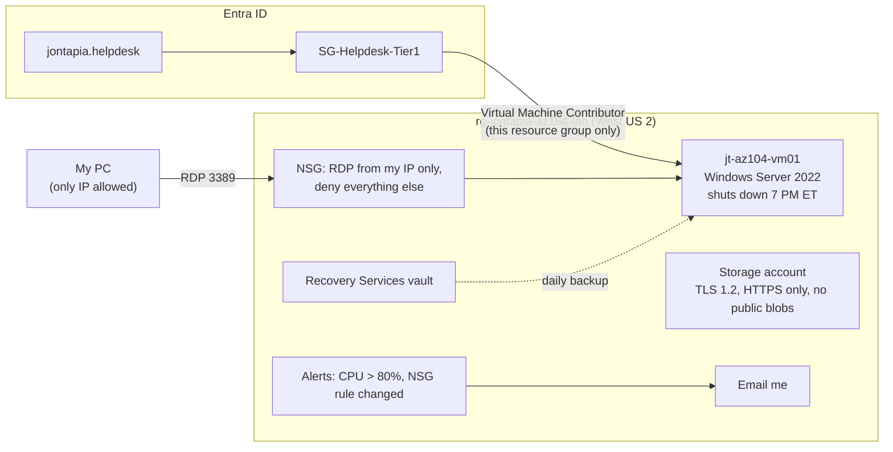
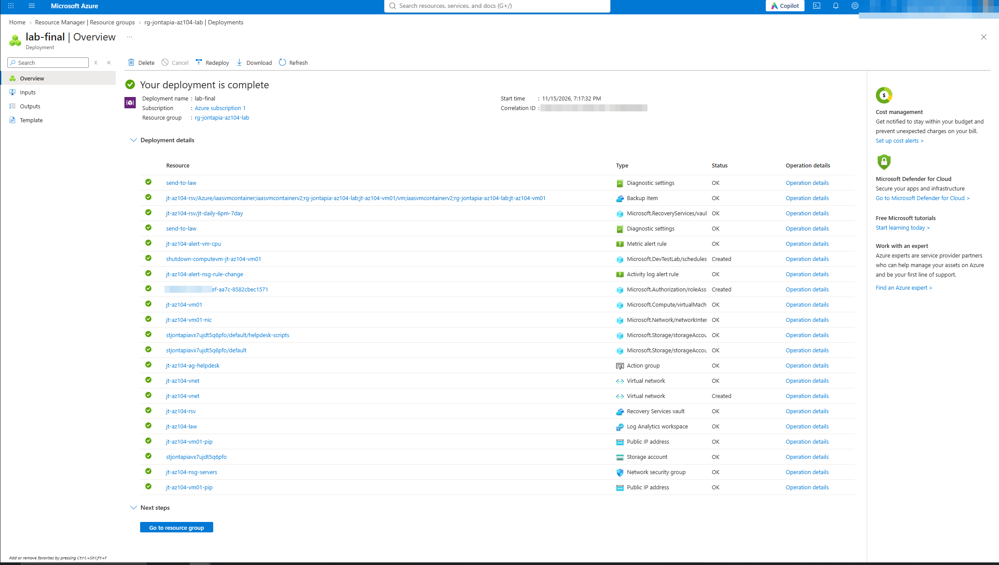
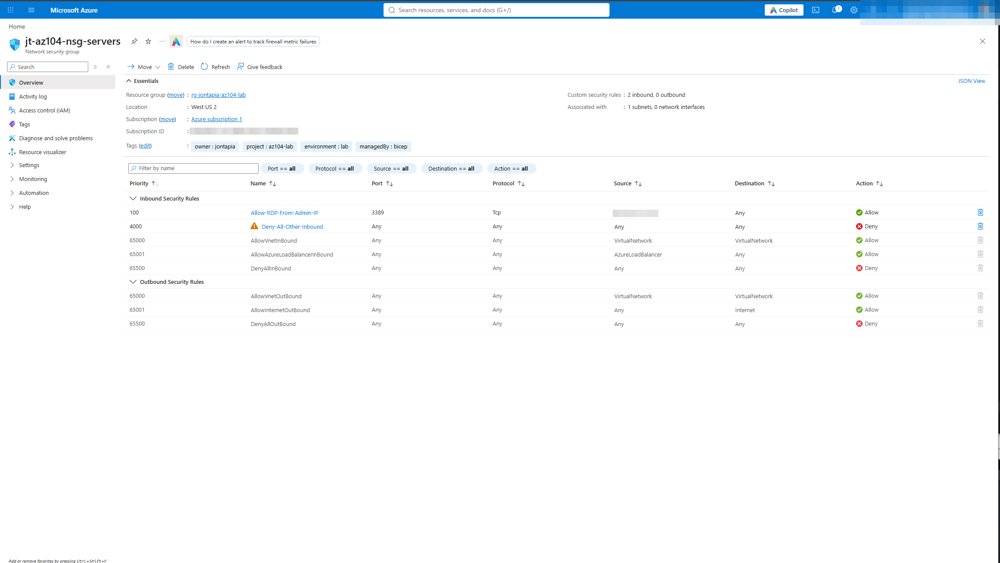
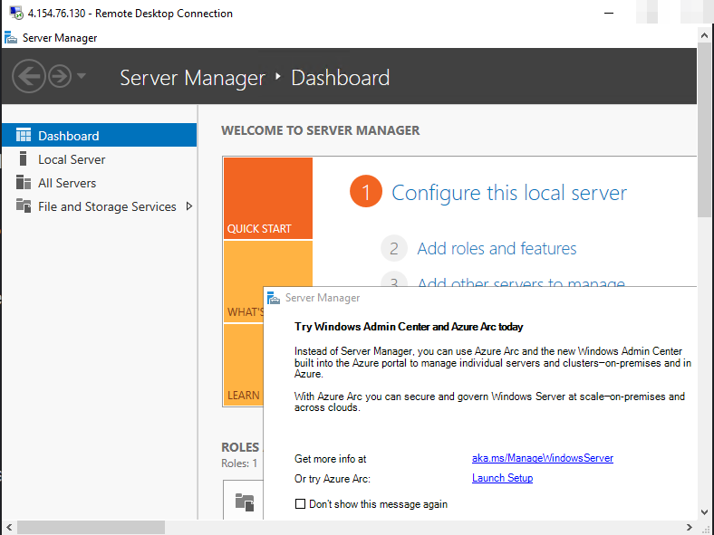

# Azure Help Desk Lab (AZ-104)

After passing AZ-104 I wanted to actually build the things the exam covers, instead of just knowing the answers to show that I understand more than just the material and know how to build. This lab sets up a small Azure environment a help desk would support: a user and group in Entra ID, a server, network rules, backups and alerts. Using IAC to deploy the resources 

It's the cloud follow-up to my [Active Directory home lab](https://github.com/jontapia/ad-homelab-jt) and [Jira help desk simulation](https://github.com/jontapia/jiraticketing).

## What it builds

| Piece | How I set it up |
|---|---|
| Entra ID | Test user `jontapia.helpdesk` in group `SG-Helpdesk-Tier1` (created by `deploy.sh`) |
| RBAC | The group gets **Virtual Machine Contributor**, scoped to the resource group only |
| Network | VNet `10.20.0.0/16`, one subnet, NSG that allows RDP from my home IP and denies everything else |
| VM | Windows Server 2022, auto patching, boot diagnostics, auto-shutdown at 7 PM |
| Storage | LRS, TLS 1.2 minimum, HTTPS only, public blob access off, 7-day soft delete |
| Backup | Recovery Services vault, daily backup at 6 PM, keep 7 days |
| Monitoring | Log Analytics, CPU alert, and an alert that emails me when anyone changes an NSG rule |
| Tags | `owner`, `project`, `environment`, `managedBy` on everything |

## Why I made these choices

- **Virtual Machine Contributor instead of Contributor.** I believe that principle of least privilege is one of the most important aspect when assigning roles to users. A Tier 1 tech should be able to restart a server, not open firewall ports. This role can manage the VM but not the network or storage it uses which could prevent malicious actors from abusing the role of an account. I scoped it to the resource group so a compromised help desk account can't reach anything else in the subscription to limit the scope if there was any malicious actors.
- **RDP only from my IP.** Leaving 3389 open to the internet is an open door for malicious actors/hackers to get into a system. The explicit deny rule isn't strictly needed (Azure has a default deny), but it makes the intent obvious when you look at effective security rules.
- **Alert on NSG changes.** Someone opening a port is one of the most common ways a cloud environment gets exposed, so I want to know about it right away and be able to make any changes if its needed.
- **Soft delete is off on the backup vault.** That's only so I can delete the lab the same day. In production I'd leave it on, because attackers go after backups first, and also it is a lifesaver if your were to ever accidentally delete an important resources.
- **Auto-shutdown and teardown script.** I'm on the free trial, so I used a script to make sure to spend as little as possible

## Proof it ran

| | |
|---|---|
|  |  |
|  |  |
|  |  |
|  | |

## Troubleshooting (what actually went wrong)

The first deploy didn't work. This is what I hit and how I fixed it:

1. **`SkuNotAvailable` for Standard_B2s in East US.** I tried four other sizes and every one failed the same way. The problem wasn't the size: my free-trial subscription had no access to East US capacity at all which was odd because the capacity of East Us should be available.
2. **Moved to West US 2.** Resources don't have to be in the same region as their resource group, so I passed `location=westus2` without recreating anything. `Standard_B2als_v2` passed all the checks and validation.
3. **`InvalidResourceLocation` while testing regions.** A half-finished attempt had already created the Log Analytics workspace in West US 2, so every other region failed because that name was taken. Lesson: once one region gets past validation, make sure to keep using that if it fits all of your needs, so you don't have to keep going around to see which one is working.
4. **`BMSUserErrorRedundancySettingsUseVaultApi`.** I was setting backup storage redundancy with the separate `backupstorageconfig` resource, which Azure now rejects. I moved it to `redundancySettings` on the vault itself, and the deploy went through.
5. **Teardown.** A vault with backup data blocks the resource group from being deleted, so the backup has to be stopped and its data deleted first. `teardown.sh` does this in order, had the use of AI here as it helped me boost productivity, and saved a lot of time manually deleting resources

## What I tested

1. **RBAC scope:** confirmed in IAM that `SG-Helpdesk-Tier1` only has Virtual Machine Contributor on this resource group (screenshot 3).
2. **NSG change alert:** edited the RDP rule and the `jt-az104-alert-nsg-rule-change` alert fired three times within minutes (screenshot 5).
3. **Backup:** VM registered with the `jt-daily-6pm-7day` policy and passed the backup pre-check (screenshot 6). The first scheduled backup was still pending when I tore the lab down.
4. **Access:** RDP'd into the VM from my allowed IP (screenshot 7).

<!-- If you also signed in as jontapia.helpdesk and got denied editing the NSG, add it here as #5 with a screenshot. -->

## Files

| File | What it does | AI was implemented to help me troubleshoot and resolve code errors
|---|---|
| `main.bicep` | Every Azure resource (network, VM, RBAC, storage, backup, monitoring) |
| `deploy.sh` | Creates the Entra user and group, then deploys the Bicep |
| `teardown.sh` | Stops backup, deletes backup data, deletes the resource group |
