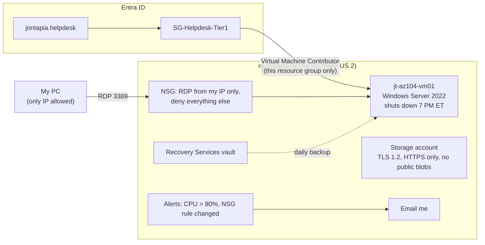
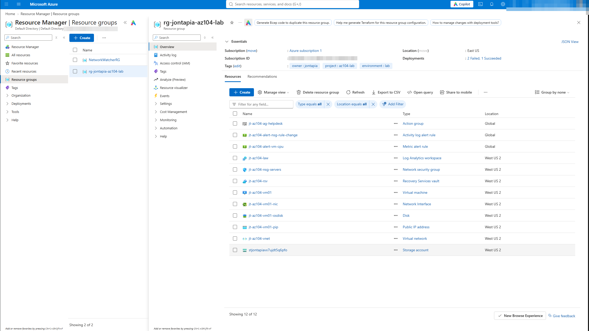
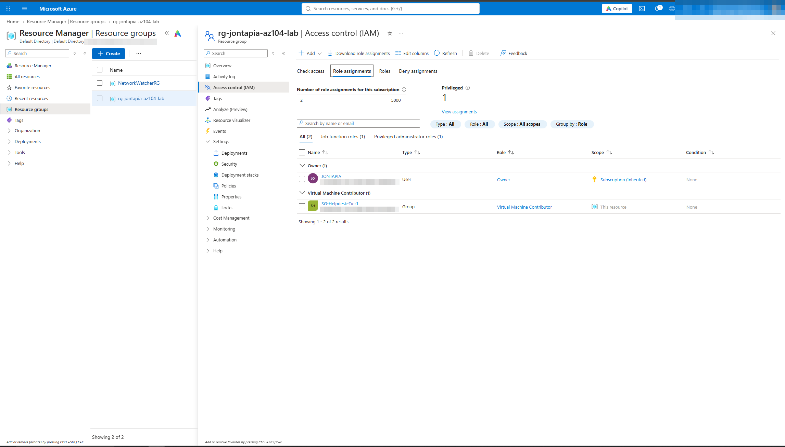
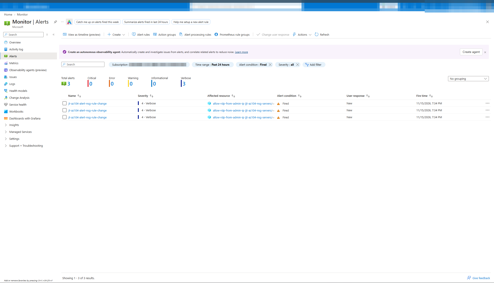
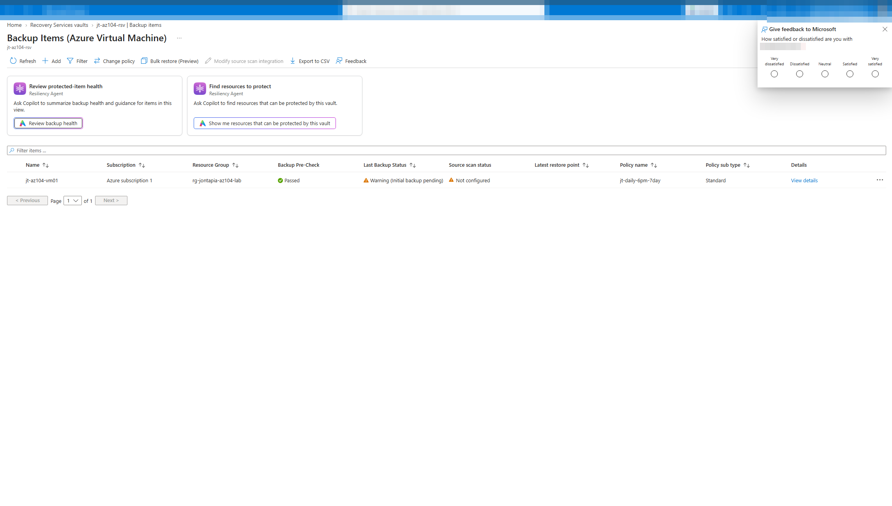

# Azure Help Desk Lab (AZ-104)

Jonathan Tapia · AZ-104 · CompTIA A+ / Network+ / Security+

After passing AZ-104 I wanted to actually build the things the exam covers, instead of just knowing the answers. This lab sets up a small Azure environment a help desk would support: a user and group in Entra ID, a server, network rules, backups and alerts. I wrote it in Bicep so I can tear it down and rebuild it in about 10 minutes instead of clicking through the portal every time.

It's the cloud follow-up to my [Active Directory home lab](https://github.com/jontapia/ad-homelab) and [Jira help desk simulation](https://github.com/jontapia/jiraticketing).

## What it builds



| Piece | How I set it up |
|---|---|
| Entra ID | Test user `jontapia.helpdesk` in group `SG-Helpdesk-Tier1` (created by `deploy.sh`) |
| RBAC | The group gets **Virtual Machine Contributor**, scoped to the resource group only |
| Network | VNet `10.20.0.0/16`, one subnet, NSG that allows RDP from my home IP and denies everything else |
| VM | Windows Server 2022, auto patching, boot diagnostics, auto-shutdown at 7 PM |
| Storage | LRS, TLS 1.2 minimum, HTTPS only, public blob access off, 7-day soft delete |
| Backup | Recovery Services vault, daily backup at 6 PM, keep 7 days |
| Monitoring | Log Analytics, CPU alert, and an alert that emails me when anyone changes an NSG rule |
| Tags | `owner`, `project`, `environment`, `managedBy` on everything |

## Why I made these choices

- **Virtual Machine Contributor instead of Contributor.** A Tier 1 tech should be able to restart a server, not open firewall ports. This role can manage the VM but not the network or storage it uses. I scoped it to the resource group so a compromised help desk account can't reach anything else in the subscription.
- **RDP only from my IP.** Leaving 3389 open to the internet gets you brute-forced within hours. The explicit deny rule isn't strictly needed (Azure has a default deny), but it makes the intent obvious when you look at effective security rules.
- **Alert on NSG changes.** Someone opening a port is one of the most common ways a cloud environment gets exposed, so I want to know about it right away.
- **Soft delete is off on the backup vault.** That's only so I can delete the lab the same day. In production I'd leave it on, because attackers go after backups first.
- **Auto-shutdown and teardown script.** I'm on the free trial, so cost control mattered.

## Proof it ran

| | |
|---|---|
|  |  |
|  |  |
|  |  |
|  | |

## Troubleshooting (what actually went wrong)

The first deploy didn't work. This is what I hit and how I fixed it:

1. **`SkuNotAvailable` for Standard_B2s in East US.** I tried four other sizes and every one failed the same way. The problem wasn't the size: my free-trial subscription had no access to East US capacity at all.
2. **Moved to West US 2.** Resources don't have to be in the same region as their resource group, so I passed `location=westus2` without recreating anything. `Standard_B2als_v2` passed validation there.
3. **`InvalidResourceLocation` while testing regions.** A half-finished attempt had already created the Log Analytics workspace in West US 2, so every other region failed because that name was taken. Lesson: once one region gets past validation, stick with it.
4. **`BMSUserErrorRedundancySettingsUseVaultApi`.** I was setting backup storage redundancy with the separate `backupstorageconfig` resource, which Azure now rejects. I moved it to `redundancySettings` on the vault itself, and the deploy went through.
5. **Teardown.** A vault with backup data blocks the resource group from being deleted, so the backup has to be stopped and its data deleted first. `teardown.sh` does this in order.

## What I tested

1. **RBAC scope:** confirmed in IAM that `SG-Helpdesk-Tier1` only has Virtual Machine Contributor on this resource group (screenshot 3).
2. **NSG change alert:** edited the RDP rule and the `jt-az104-alert-nsg-rule-change` alert fired three times within minutes (screenshot 5).
3. **Backup:** VM registered with the `jt-daily-6pm-7day` policy and passed the backup pre-check (screenshot 6). The first scheduled backup was still pending when I tore the lab down.
4. **Access:** RDP'd into the VM from my allowed IP (screenshot 7).

<!-- If you also signed in as jontapia.helpdesk and got denied editing the NSG, add it here as #5 with a screenshot. -->

## Run it yourself

You need an Azure subscription where you're Owner (a free trial works) and Entra rights to create users and groups.

```bash
# Azure Cloud Shell (Bash)
git clone https://github.com/jontapia/jontapia-az104-lab.git
cd jontapia-az104-lab
chmod +x deploy.sh teardown.sh
LOCATION=westus2 VM_SIZE=Standard_B2als_v2 ./deploy.sh
```

It asks for your home public IP, an alert email and a VM password. When you're done:

```bash
./teardown.sh          # deletes the Azure resources, keeps the Entra user/group
./teardown.sh --all    # also deletes the Entra user and group
```

A few hours costs well under a dollar. Don't leave it running, though.

## Files

| File | What it does |
|---|---|
| `main.bicep` | Every Azure resource (network, VM, RBAC, storage, backup, monitoring) |
| `deploy.sh` | Creates the Entra user and group, then deploys the Bicep |
| `teardown.sh` | Stops backup, deletes backup data, deletes the resource group |
